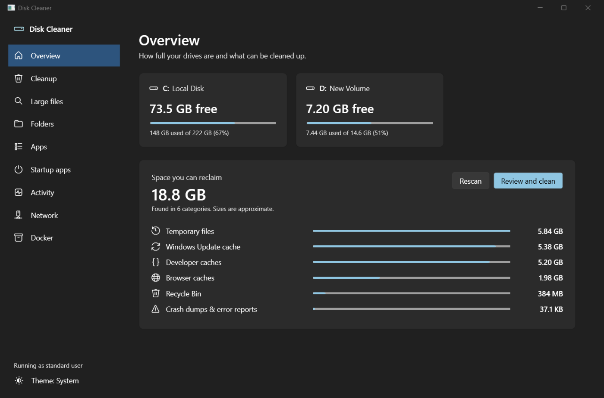
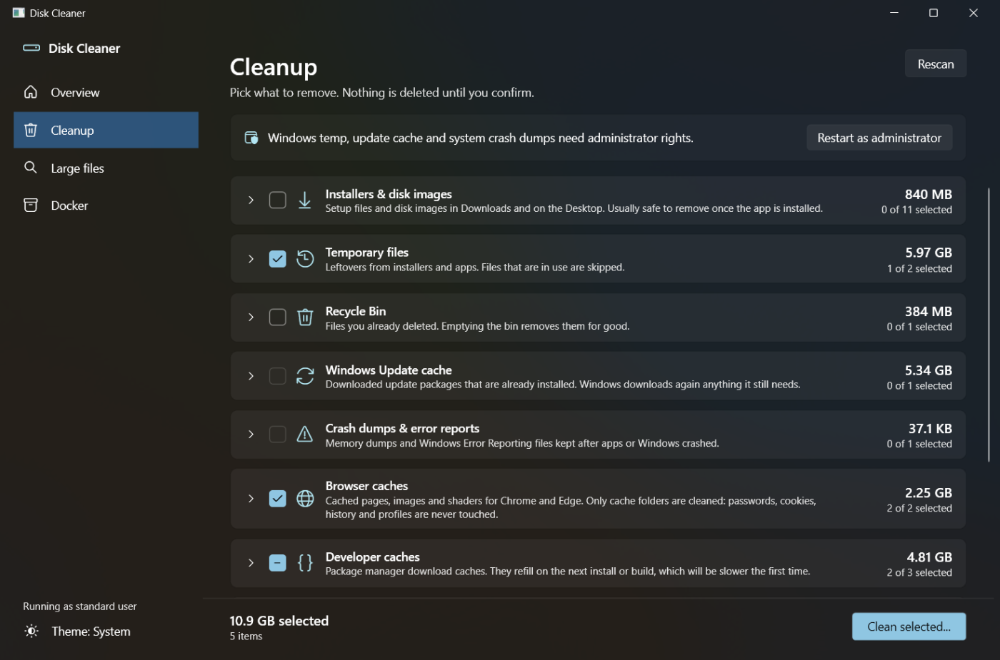
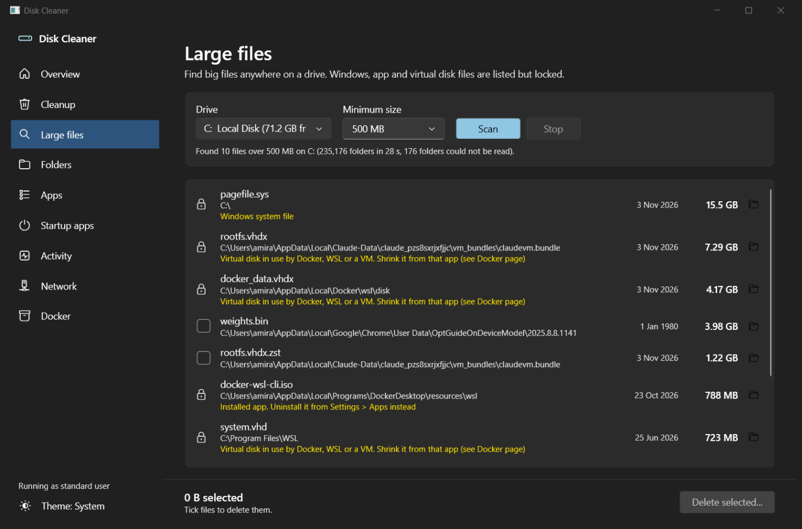
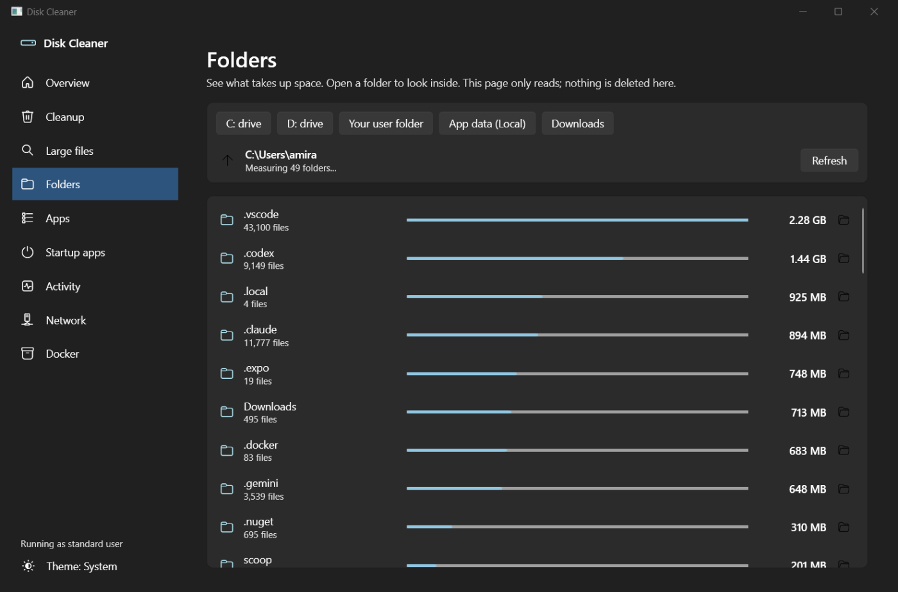
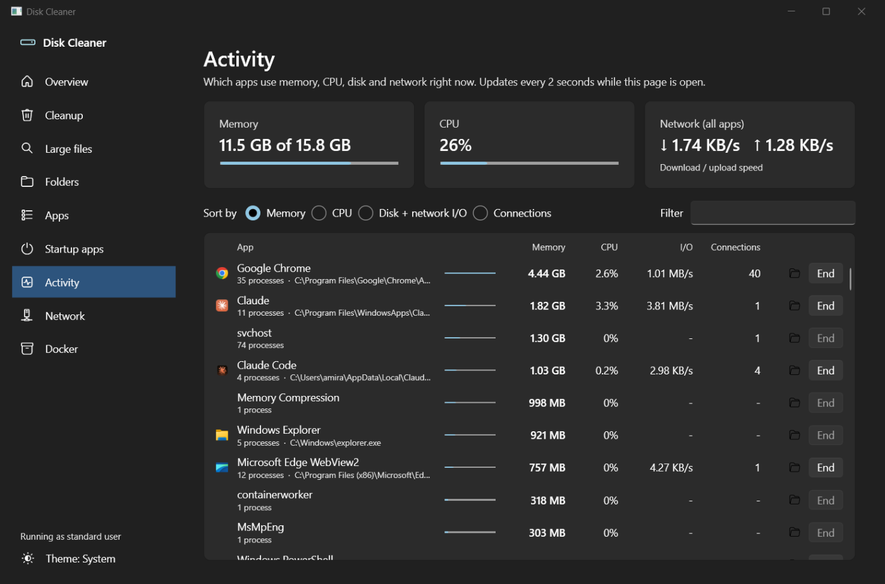
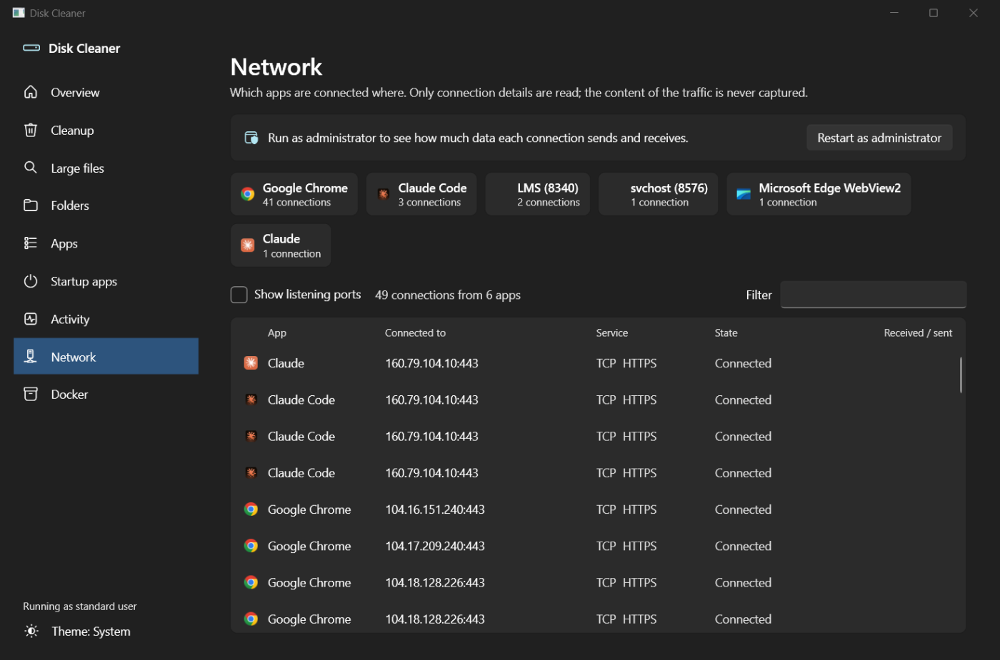
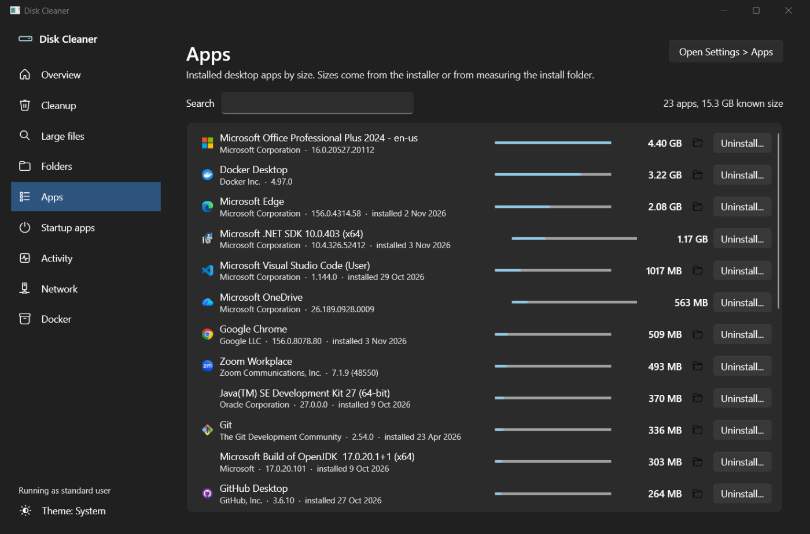
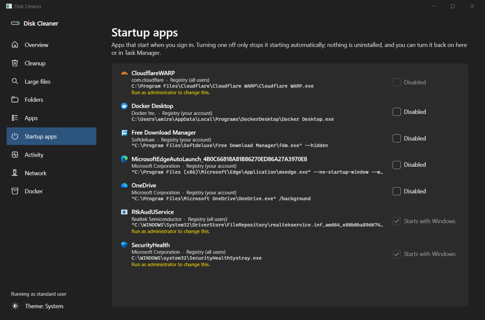
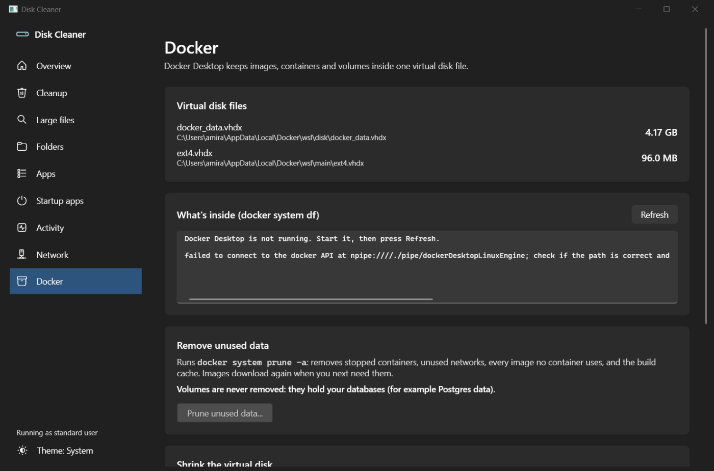

<div align="center">

# Disk Cleaner

**See what is filling your Windows drive, clean it safely, and find out which apps use your memory, CPU and network.**


[](https://github.com/syedamerzaidi/disk-cleaner/releases/latest)
[](https://github.com/syedamerzaidi/disk-cleaner/actions/workflows/release.yml)

### [⬇ Download DiskCleaner.exe](https://github.com/syedamerzaidi/disk-cleaner/releases/latest/download/DiskCleaner-standalone.exe)

<sub>~70 MB · nothing else to install</sub>



</div>

---

## Why

Windows' own tools spread this across Disk Cleanup, Storage Sense, Task Manager, Resource Monitor and Settings — and none of them know about `npm-cache`, the pnpm store, Gradle, NuGet or Docker's ever-growing `docker_data.vhdx`. Disk Cleaner puts it all in one small, fast native app, and never deletes anything without showing you exactly what will go first.

## Features

### Storage

- **Overview** — free/used space for every drive and a breakdown of reclaimable space.
- **Cleanup** — one list with sizes and checkboxes:
  - Installers and disk images in Downloads and on the Desktop (`.exe`, `.msi`, `.msix`, `.iso`, `.apk`, ...)
  - Your temp folder and the Windows temp folder
  - Recycle Bin
  - Windows Update download cache
  - Crash dumps and Windows Error Reporting files
  - Chrome and Edge **cache folders only**
  - Developer caches: npm, pnpm store, Gradle, NuGet, pip, Yarn
  - Unity Hub downloads, Android SDK leftover downloads
  - `hiberfil.sys` / `pagefile.sys` sizes with step-by-step instructions to shrink them
- **Large files** — finds every file above a size you choose (default 500 MB) on any drive. Multi-threaded: about 1 million files in ~20 s.
- **Folders** — read-only drill-down to see which folders are biggest.
- **Docker** — `docker_data.vhdx` size, `docker system df`, one-click prune, and how to compact the virtual disk afterwards.



### Apps and system

- **Apps** — installed desktop apps sorted by size; open the install folder or launch the app's own uninstaller.
- **Startup apps** — turn sign-in apps on or off (reversible, same switch Task Manager uses).
- **Activity** — live per-app memory, CPU, disk + network I/O and open connections, with system memory, CPU and network speed. End an app if it misbehaves.
- **Network** — which app is connected to which server: host name, address, port and service (HTTPS, DNS, PostgreSQL, ...). Run as administrator to also see bytes received and sent per connection.

### Design

- Windows 11 Fluent look with Mica, follows your light/dark setting (or pick one).
- Keyboard accessible, screen-reader labels on icon buttons, adapts to narrow windows.
- One ~330 KB executable. No installer, no background service, no telemetry, nothing sent anywhere.

## Screenshots

| | |
| --- | --- |
| **Large files** — system and app files are locked<br> | **Folders** — what takes up space<br> |
| **Activity** — memory, CPU, I/O per app<br> | **Network** — which app talks to which server<br> |
| **Apps** — installed apps by size<br> | **Startup apps** — turn sign-in apps on or off<br> |
| **Docker** — disk size, prune, compaction steps<br> | **Cleanup** — pick what to remove<br> |

## Safety first

| Guard | Detail |
| --- | --- |
| Confirm before delete | A dialog lists every item with its size. Cancel has focus, so Enter never deletes by accident. |
| Recycle Bin by default | "Delete permanently" is an explicit choice. Emptying the Recycle Bin is always permanent and the dialog says so. |
| Honest results | Shows what was removed, what was skipped (in use / no access) and how much free space each drive actually gained. |
| Locked locations | Windows, Program Files, ProgramData, per-user installed apps, virtual disks (`.vhdx`, `.vhd`, `.vmdk`) and system files are listed but cannot be selected. |
| Browser data | Only `Cache`, `Code Cache`, `GPUCache` and shader caches. Never passwords, cookies, history or profiles. |
| Links | Junctions and symlinks are never followed; only the link itself is removed. |
| Docker | `docker system prune -a -f` **without `--volumes`**, so your databases survive. |
| Network | Reads connection tables only. Traffic content is never captured. |
| Least privilege | Runs as a normal user. Admin-only items offer **Restart as administrator**. |

## Install

No installer: download one file and run it.

[**Download DiskCleaner.exe**](https://github.com/syedamerzaidi/disk-cleaner/releases/latest/download/DiskCleaner-standalone.exe) (~70 MB). Nothing else to install, .NET is built in.

The link always points to the newest version. Older versions and SHA-256 checksums are on the [Releases](https://github.com/syedamerzaidi/disk-cleaner/releases) page.

Windows SmartScreen may warn because the exe is not code-signed: choose **More info › Run anyway**, or build it yourself.

### Releases

Every code change pushed to `main` is built by [GitHub Actions](.github/workflows/release.yml) and published as a new release automatically. The version is `major.minor` from `DiskCleaner.csproj` plus the build number (for example `1.0.7`); bump `<Version>` in the project file for a new major or minor version. Changes to docs only don't create a release.

## Build from source

Requires the [.NET 10 SDK](https://dotnet.microsoft.com/download/dotnet/10.0).

```bash
git clone https://github.com/syedamerzaidi/disk-cleaner.git
cd disk-cleaner
dotnet run
```

Single-file exe (framework-dependent, ~330 KB):

```bash
dotnet publish -c Release
```

Self-contained exe that runs without .NET installed (~70 MB):

```bash
dotnet publish -c Release --self-contained true -p:IncludeNativeLibrariesForSelfExtract=true
```

Output: `bin/Release/net10.0-windows/win-x64/publish/DiskCleaner.exe`.

## Project layout

```text
App.xaml                 Fluent theme, shared styles
MainWindow.xaml(.cs)     Layout, Overview, Cleanup, Large files, Docker
MainWindow.Storage.cs    Folders, Apps, Startup apps
MainWindow.Live.cs       Activity, Network
ConfirmDialog.xaml       Confirm and result dialogs
src/
  FileWalker.cs          Fast iterative FindFirstFileEx walker (single and multi-threaded)
  Catalog.cs             Cleanup categories and measuring
  Cleaner.cs, Safety.cs  Deleting and the guards around it
  LargeFileFinder.cs, FolderSizer.cs
  ActivityMonitor.cs, NetworkMonitor.cs, ProcessDirectory.cs
  InstalledApps.cs, StartupManager.cs, DockerTools.cs
  Native.cs, NativeSys.cs  Win32 interop
```

Theme choice is stored in `%LOCALAPPDATA%\DiskCleaner\settings.txt`; unexpected errors go to `error.log` in the same folder.

## FAQ

**Space didn't go down after cleaning.** Items moved to the Recycle Bin still use space until the bin is emptied. Choose "Delete permanently" or empty the bin afterwards.

**Docker's .vhdx is still huge after prune.** Virtual disks don't shrink on their own. Follow the "Shrink the virtual disk" steps on the Docker page.

**Why does deleting the pnpm store free less than shown?** Projects hard-link into the store, so files still used by a `node_modules` folder keep their space. `pnpm store prune` is the gentler option.

**Why no per-app network bytes without admin?** Windows only exposes per-connection byte counters to administrators.

## Contributing

Issues and pull requests are welcome. Please keep the safety guarantees above intact: anything that deletes must go through the confirm dialog and `Safety` checks.

## License

[MIT](LICENSE) © 2026 Syed Muhammad Amer Ali Zaidi
